[README.md](https://github.com/user-attachments/files/34156506/README.md)

 

<a href="https://www.linkedin.com/in/<tu-usuario>"></a>
<a href="mailto:<tu-email>"></a>
<a href="https://<tu-web>"></a>

---

### `$ cat about.md`

Una o dos frases claras sobre quién eres, a qué te dedicas y qué tipo de problemas te gusta resolver.

- 🔭 Trabajando en: **<proyecto o área>**
- 🌱 Aprendiendo: **<tecnología>**
- 💬 Pregúntame sobre: **<temas>**

### `$ ls ~/skills`

  
  
  
  
  

### `$ ls ~/projects`

| Proyecto | Descripción | Stack |
|---|---|---|
| [**previwerpdf**](https://github.com/<tu-usuario>/previwerpdf) | Extensión de navegador (Manifest V3, código abierto) que fuerza la previsualización de PDF en lugar de descargarlos. | JavaScript · declarativeNetRequest |
| [**<proyecto 2>**](https://github.com/<tu-usuario>/<repo>) | <qué hace y qué problema resuelve> | <stack> |

### `$ git stats`

  &show_icons=true&hide_border=false&bg_color=0b0b0f&title_color=ff3b3b&text_color=d8d8e0&icon_color=ff3b3b&border_color=2b2b35" />
  &layout=compact&bg_color=0b0b0f&title_color=ff3b3b&text_color=d8d8e0&border_color=2b2b35" />

