---

### `$ cat about.md`

- 🔭 Trabajando en: **<proyecto o área>**
- 🌱 Aprendiendo: **<tecnología>**
- 💬 Pregúntame sobre: **<temas>**

### `$ ls ~/skills`

<!--SKILLS:START-->

  
  
  

<!--SKILLS:END-->

### `$ ls ~/projects`

<!--PROJECTS:START-->
| Proyecto | Descripción | Lenguaje | ★ |
|---|---|---|---|
| [**picoducky-2w**](https://github.com/themanoftheredshadow/picoducky-2w) | Sin descripción todavía | - | 1 |
| [**f-devops-lab**](https://github.com/themanoftheredshadow/f-devops-lab) | Laboratorio basico administración, DevOps junto a Docker | Dockerfile | 0 |
| [**previwerpdf**](https://github.com/themanoftheredshadow/previwerpdf) | Extensión de navegador. | JavaScript | 0 |
| [**Transparent**](https://github.com/themanoftheredshadow/Transparent) | Programa KeyLogger python3 | Python | 1 |
<!--PROJECTS:END-->

### `$ git stats`

  
  

