---

### `$ cat about.md`

Una o dos frases claras sobre quién eres, a qué te dedicas y qué tipo de problemas te gusta resolver.

- 🔭 Trabajando en: **[proyecto o área]**
- 🌱 Aprendiendo: **[tecnología]**
- 💬 Pregúntame sobre: **[temas]**

### `$ ls ~/skills`

<!--SKILLS:START-->

  
  

<!--SKILLS:END-->

### `$ ls ~/projects`

<!--PROJECTS:START-->
| Proyecto | Descripción | Lenguaje | ★ |
|---|---|---|---|
| [**f-devops-lab**](https://github.com/themanoftheredshadow/f-devops-lab) | Sin descripción todavía | Python | 0 |
| [**previwerpdf**](https://github.com/themanoftheredshadow/previwerpdf) | Sin descripción todavía | JavaScript | 0 |
| [**Transparent**](https://github.com/themanoftheredshadow/Transparent) | Sin descripción todavía | Python | 1 |
<!--PROJECTS:END-->

### `$ git stats`

  
  

